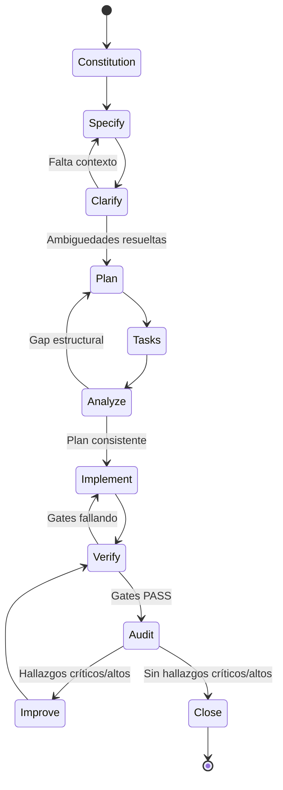

# GOVERNANCE.md — Protocolo Universal de Gobernanza, Ejecución, Verificación y Auditoría

**Versión:** 1.0.0  
**Estado:** Obligatorio  
**Aplica a:** Cualquier proyecto, lenguaje, framework, runtime, arquitectura, proveedor, infraestructura, CLI, API, librería, sistema batch, frontend, backend, datos, automatización, integración o sistema híbrido.  
**Dirigido a:** IAs ejecutoras, agentes de código, asistentes técnicos y equipos humanos que intervengan sobre el proyecto.

---

## 0. Propósito

Este documento define las reglas obligatorias para analizar, especificar, planificar, implementar, verificar, auditar, corregir y cerrar cualquier cambio en un proyecto.

No es una guía opcional. No es una recomendación. Es un protocolo de ejecución.

Ninguna tarea se considera terminada mientras exista:

- Un gate obligatorio fallando.
- Un test crítico fallando.
- Una ambigüedad sin resolver.
- Una traza incompleta.
- Una dependencia no declarada.
- Un riesgo crítico o alto sin mitigación.
- Evidencia ausente, parcial o no reproducible.

Queda prohibido usar expresiones de incertidumbre como cierre:

- “Yo creo que funciona.”
- “Debería funcionar.”
- “Parece correcto.”
- “Probablemente esté bien.”
- “No debería fallar.”
- “Lo probé por encima.”

Solo se acepta evidencia verificable: comandos ejecutados, resultados, tests, logs, evidencias de auditoría, commits, reportes o artefactos reproducibles.

---

## 1. Reglas de interpretación

1. **Obligatoriedad.**  
   Todo lo marcado como “debe”, “obligatorio”, “requiere” o “gate” es bloqueante.

2. **No suposición.**  
   La IA no debe asumir dependencias, APIs, variables de entorno, librerías, configuraciones, permisos, credenciales, datos, comportamientos ni restricciones. Si no está declarado, debe verificarse o preguntarse.

3. **Evidencia sobre opinión.**  
   Toda afirmación de correctness requiere evidencia reproducible.

4. **Cierre condicional.**  
   Una tarea solo se cierra cuando el 100% de los gates aplicables están en estado PASS.

5. **Excepción documentada.**  
   Si un requisito no puede cumplirse, no se omite en silencio. Se registra como deuda operativa o ADR, con riesgo, impacto, mitigación, responsable y fecha.

6. **Jerarquía normativa.**  
   En caso de conflicto, el orden de prioridad es:

   1. Constitución.
   2. Flujo de estados.
   3. Gates de cierre.
   4. Criterios medibles.
   5. Requisitos operativos.
   6. Convenciones locales del proyecto.

7. **Adaptación al stack.**  
   Este documento define capacidades obligatorias, no herramientas específicas. El stack local decide cómo implementarlas si cumple la capacidad.

8. **Bloqueo ante ambigüedad.**  
   Si falta información crítica, la IA debe detenerse y preguntar. No debe inventar requisitos ni completar huecos con supuestos.

---

## 2. Constitución del proyecto

Estos principios prevalecen sobre cualquier preferencia local.

### 2.1 Integridad de dependencias y configuración

- No se asumen librerías, comandos, servicios, variables de entorno, archivos, bases de datos, secretos, endpoints ni permisos.
- Toda dependencia debe estar declarada en el manifiesto correspondiente del proyecto: `package.json`, `requirements.txt`, `pyproject.toml`, `go.mod`, `Cargo.toml`, `pom.xml`, `build.gradle`, `*.csproj`, `composer.json`, `Gemfile`, etc.
- Si existe lockfile, debe respetarse: `package-lock.json`, `pnpm-lock.yaml`, `yarn.lock`, `poetry.lock`, `Pipfile.lock`, `Cargo.lock`, etc.
- Si una dependencia no está declarada, se considera inexistente hasta verificarla.
- No se permiten dependencias fantasma, scripts no documentados ni configuraciones implícitas sin trazabilidad.

### 2.2 Trazabilidad total

Toda decisión técnica relevante debe poder trazarse desde el requisito hasta la evidencia.

La cadena mínima de trazabilidad es:

```text
Requisito → ADR / decisión → Plan → Tarea → Implementación → Commit/PR → Test → Evidencia → Auditoría → Cierre
```

Ninguna decisión importante queda solo en conversación.

### 2.3 Calidad verificada

- Ningún código se considera completado sin tests.
- Si el proyecto tiene framework de pruebas, se usa ese.
- Si no tiene framework, la primera tarea técnica es instalar/configurar el estándar del stack.
- Si no se puede automatizar una prueba, se define una verificación manual reproducible.
- Un test intermitente se considera fallo hasta que se estabiliza o se aísla con justificación formal.

### 2.4 Seguridad, privacidad y validación

Todo proyecto debe aplicar controles de seguridad apropiados a su dominio y stack.

Como mínimo:

- Validación de entradas en toda frontera de confianza.
- Validación de salidas cuando haya renderizado, serialización, comandos, queries o integración con sistemas externos.
- Control de acceso explícito: autenticación, autorización y mínimo privilegio.
- Protección contra inyección: SQL, comandos, plantillas, LDAP, XML, XSS, SSRF, path traversal, deserialización insegura u otras relevantes.
- Cifrado en tránsito cuando haya comunicación de red.
- Cifrado en reposo para datos sensibles si el sistema lo soporta.
- Prohibición de secretos en código, logs, tests, commits, artefactos o configuración versionada.
- Gestión de secretos mediante mecanismo seguro del entorno.
- Análisis de dependencias vulnerables cuando exista herramienta disponible.
- Si el proyecto maneja datos personales o sensibles: minimización, enmascaramiento, control de acceso y trazabilidad de operaciones sensibles.

### 2.5 Fiabilidad y manejo de fallos

El sistema debe comportarse de forma predecible ante fallos.

Se deben definir:

- Timeouts para llamadas externas.
- Reintentos con backoff cuando aplique.
- Idempotencia para operaciones críticas.
- Degradación controlada.
- Manejo explícito de errores.
- Prohibición de fallos silenciosos.
- Estrategia de fallback o circuito de corte cuando una dependencia crítica pueda caer.

### 2.6 Rendimiento

- Toda operación crítica debe tener un criterio de rendimiento aceptable.
- Si no hay criterio definido, se establece una línea base durante `/plan`.
- No se aceptan regresiones de rendimiento no justificadas.
- Si una mejora o cambio introduce latencia, consumo o costo significativamente mayor, debe registrarse un ADR.

### 2.7 Observabilidad

El sistema debe poder diagnosticarse en producción o en ejecución real.

Se requiere:

- Logs estructurados.
- IDs de correlación.
- Contexto de usuario/actor cuando exista.
- Registro de errores con stack trace.
- Métricas mínimas de salud si el sistema es servible.
- Trazas de ejecución para flujos críticos cuando el stack lo permita.

### 2.8 Preferencia por software libre

Al elegir herramientas, librerías, servicios o plataformas:

- Se priorizan opciones open-source con licencia permisiva y compatible.
- Se evita vendor lock-in innecesario.
- Para observabilidad, seguridad y manejo de datos críticos, se prefiere software auto-hosteable o con exportación libre de datos.
- Una alternativa propietaria solo se acepta si no existe equivalente funcional viable.
- Si se usa una opción propietaria, debe registrarse: motivo, licencia, costo, riesgo de lock-in, plan de salida y alternativas evaluadas.

### 2.9 Código sin narrativa

La IA no debe añadir comentarios narrativos dentro del código tales como:

- “Cambié esto porque…”
- “Arreglé este error…”
- “Antes fallaba por…”
- “Esto se movió por…”
- “Debug temporal…”
- “Comentario para revisar luego…”

La trazabilidad vive en commits, ADRs, tareas, reporte de verificación y auditoría.

Solo se permiten comentarios técnicos cuando explican una restricción no obvia, invariante de negocio, trampa conocida del dominio o comportamiento crítico del sistema.

### 2.10 Reversibilidad

Todo despliegue, migración o cambio estructural debe contemplar reversión o recuperación.

Se requiere:

- Plan de rollback explícito.
- Migraciones compatibles con reversión cuando aplique.
- Mecanismo de restauración de estado anterior.
- Feature flags o despliegue incremental cuando el contexto lo permita.
- Si rollback inmediato no es posible, documentar RTO/RPO y procedimiento alternativo.

### 2.11 Diseño intencional de UI

Todo elemento de interfaz de usuario debe tener un propósito claro, justificado y verificable.

Prohibido:

- Elementos decorativos sin función (botones que no hacen nada, modales innecesarios, links muertos).
- Componentes añadidos "porque se ven bien" o "para llenar espacio".
- Modales para información que puede mostrarse inline.
- Drawers que duplican funcionalidad de otras vistas.
- Inputs sin validación ni propósito claro en el flujo.
- Animaciones o efectos sin justificación de UX.
- Obligatorio:
- Cada botón, link, input, modal, drawer o componente debe resolver un caso de uso específico.
- Cada interacción debe tener un resultado medible y observable.
- La justificación de cada elemento UI debe trazarse desde el requisito.
- Si un elemento no cumple función crítica, debe eliminarse o justificarse con ADR.
- Criterio de aceptación:
- 0 elementos UI sin propósito documentado.
- 100% de componentes con caso de uso verificable.
- Auditoría de UI confirma que cada elemento cumple función específica.

---

## 3. Flujo obligatorio de estados

Toda solicitud de desarrollo, corrección, mejora, auditoría o refactor debe pasar por este flujo.

No se permite saltar estados ni combinarlos de forma descontrolada.

| Estado | Objetivo | Salida obligatoria | Regla de bloqueo |
|---|---|---|---|
| `/constitution` | Confirmar reglas, stack, versiones, restricciones y governance aplicable. | Stack confirmado, restricciones, governance versionado. | Si falta stack o contexto, detener. |
| `/specify` | Definir qué se construye, para quién y por qué. | Propósito, usuarios, criterio de éxito, alcance y fuera de alcance. | Si no hay criterio de aceptación, detener. |
| `/clarify` | Identificar ambigüedades, riesgos y preguntas abiertas. | Lista de preguntas resueltas o pendientes. | La IA debe detenerse y preguntar. No continuar con dudas críticas. |
| `/plan` | Definir cómo se construirá. | Arquitectura, ADRs, modelo de datos, contratos, estrategia de tests, observabilidad, seguridad, rollback. | Si no hay plan verificable, no implementar. |
| `/tasks` | Dividir en unidades pequeñas y verificables. | Tareas atómicas, IDs, dependencias, criterios de aceptación. | Si una tarea no es verificable, rediseñar. |
| `/analyze` | Revisar coherencia entre spec, plan y tareas. | Matriz de cobertura, riesgos, diagramas, puntos de ruptura. | Si hay gap, volver a `/plan`. |
| `/implement` | Ejecutar técnicamente. | Código, tests, commits funcionales, checkpoints. | Sin test y validación por tarea, no continuar. |
| `/verify` | Probar en múltiples perspectivas. | Evidencia de gates, tests, matrices y escenarios. | Si un gate falla, volver a `/implement`. |
| `/audit` | Auditoría adversarial y estructural. | Hallazgos, severidad, trazabilidad, validación de evidencia. | Si hay hallazgo crítico/alto, no cerrar. |
| `/improve` | Corregir hallazgos y fortalecer el sistema. | Correcciones, tests actualizados, docs actualizadas. | Toda mejora debe volver a `/verify`. |
| `/close` | Cerrar solo con evidencia completa. | Reporte final, gates PASS, trazabilidad, deuda registrada si aplica. | No cerrar con evidencia parcial. |

---

## 4. Diagrama de flujo de ejecución



---

## 5. Reglas de ejecución para IAs

La IA ejecutora debe cumplir lo siguiente:

1. **Antes de implementar**, debe confirmar que entiende el requisito, el stack, el estado actual y las restricciones.
2. **Si detecta ambigüedad**, debe formular preguntas concretas y bloquear la ejecución.
3. **No debe inventar requisitos**, dependencias, endpoints, credenciales, datos ni comportamiento esperado.
4. **No debe dejar comentarios de error o narrativa** dentro del código.
5. **No debe entregar código sin tests** si existe o puede instalarse un framework de pruebas.
6. **No debe marcar como completado** aquello que no pueda verificar.
7. **Si no puede ejecutar pruebas**, debe declarar explícitamente: `BLOCKED_BY_ENVIRONMENT` y describir qué evidencia falta.
8. **No debe usar mocks como verdad de producción.** Los mocks son aceptables en tests unitarios, pero no pueden reemplazar la validación de integración real cuando esta es crítica.
9. **No debe dejar datos ficticios, placeholders, secretos de ejemplo o configuraciones temporales** en artefactos destinados a producción.
10. **Debe actualizar trazabilidad, documentación y deuda técnica** cuando el cambio afecte arquitectura, operación o comportamiento observable.

---

## 6. Gates obligatorios de cierre

Estos gates se evalúan en `/verify`, `/audit` y `/close`.

| Gate | Condición PASS | Evidencia requerida |
|---|---|---|
| Spec | El requisito tiene objetivo, alcance, criterio de aceptación y fuera de alcance. | Documento o sección de spec actualizada. |
| Clarify | No quedan preguntas críticas abiertas. | Registro de preguntas y respuestas. |
| Plan | Existe arquitectura, ADRs, modelo de datos, contratos, estrategia de tests y rollback. | Plan versionado o documento equivalente. |
| Tasks | Las tareas son atómicas, trazables y verificables. | Lista de tareas con IDs y dependencias. |
| Cobertura | Cada requisito crítico tiene tarea, test y evidencia. | Matriz de trazabilidad. |
| Código | Compila/lint/parse según stack; no introduce errores estructurales. | Salida de build/lint o validación equivalente. |
| Tests | Todos los tests obligatorios pasan. | Comando ejecutado y resultado. |
| Seguridad | No hay secretos expuestos, entradas sin validar ni vulnerabilidades críticas conocidas sin mitigación. | Checklist, escaneo o auditoría manual. |
| Datos | Migraciones, fixtures, esquemas y transformaciones son consistentes y reversibles cuando aplique. | Prueba de migración/rollback o validación de datos. |
| Observabilidad | Logs, métricas, errores y health checks cumplen criterios mínimos. | Ejemplo de log, endpoint de health o evidencia equivalente. |
| Resiliencia | Fallos de dependencias, timeouts y errores están manejados. | Pruebas de fallo o análisis documentado. |
| Rendimiento | No hay regresión no justificada sobre la línea base. | Comparativa o análisis documentado. |
| Documentación | README, CONTRIBUTING, instrucciones locales o archivo de agentes actualizados si aplica. | Diff o referencia documental. |
| Trazabilidad | Commits, tareas, tests y decisiones están conectados. | Matriz de trazabilidad. |
| Auditoría | No quedan hallazgos críticos o altos abiertos. | Reporte de auditoría. |
| UI Intencional | Cada elemento de interfaz tiene propósito documentado y caso de uso verificable. | Auditoría de componentes UI con justificación. |

---

## 7. Criterios medibles universales

Estos criterios son principios generales medibles.

Los valores por defecto son obligatorios salvo que `/plan` defina otros mediante ADR. Cambiar un valor requiere justificación explícita.

| Área | Principio | Criterio medible por defecto |
|---|---|---|
| Ambigüedad | No se implementa con dudas críticas. | 0 preguntas críticas abiertas antes de `/implement`. |
| Tests funcionales | Todo criterio de aceptación debe estar probado. | 100% de criterios de aceptación con test automatizado o evidencia manual reproducible. |
| Tests de fallo | No solo se prueba el camino feliz. | 100% de flujos críticos con al menos un escenario negativo y un escenario de fallo de dependencia. |
| Suite de pruebas | La suite no puede cerrar en rojo. | 100% de tests obligatorios PASS. |
| Tests ignorados | No se permiten skips silenciosos. | 0 tests skipped sin issue/ADR asociado. |
| Cobertura nueva | El código nuevo debe venir protegido. | Si hay métrica de cobertura: cobertura de diff ≥ 80%. Si no hay métrica: rutas críticas y ramas de error cubiertas por tests. |
| Seguridad | No se aceptan secretos expuestos. | 0 secretos detectados en código, logs, commits o configuración. |
| Vulnerabilidades | No se aceptan vulnerabilidades críticas explotables sin mitigación. | 0 vulnerabilidades críticas sin resolver; altas requieren mitigación o ADR. |
| Entradas | Toda entrada externa se valida. | 100% de endpoints/funciones públicas críticas con validación de entrada demostrable. |
| Logs | Los logs deben ser estructurados y correlacionables. | 100% de eventos críticos incluyen campos mínimos de trazabilidad. |
| Errores | Los errores deben detectarse y diagnosticarse. | Errores críticos con stack trace, contexto y alerta o registro visible. |
| Rate limiting | Todo endpoint público debe estar protegido. | 100% de endpoints públicos con límite definido y prueba de rechazo. |
| Health checks | La infraestructura debe detectar caídas. | Health/readiness falla si una dependencia crítica está caída. |
| Rollback | Debe existir retorno controlado. | Plan de rollback documentado y probado o simulado; objetivo <= 5 minutos cuando el contexto lo permita. |
| Secretos | Las credenciales deben rotar. | Rotación <= 90 días o menor según política/proveedor; sin secretos en repositorio. |
| Rendimiento | No degradar sin justificación. | Regresión <= 10% sobre línea base para operaciones críticas, salvo ADR. |
| Documentación | El cambio debe quedar documentado si altera uso, operación o arquitectura. | README/instrucciones actualizadas cuando hay impacto visible. |
| Trazabilidad | Todo cambio debe rastrearse. | 100% de tareas críticas vinculadas a requisito, commit, test y evidencia. |
| UI Intencional | Nada de adornos, todo con propósito. | 0 elementos UI sin caso de uso documentado; 100% de componentes con función verificable. |

---

## 8. Requisitos operativos universales

Estos requisitos definen capacidades. El stack decide la herramienta.

### 8.1 Logs estructurados

`console.log`, `print`, `echo` o equivalentes no son un sistema de logs.

El proyecto debe implementar logs estructurados, legibles por máquina y consultables.

Campos mínimos obligatorios:

```json
{
  "timestamp": "ISO-8601",
  "level": "debug|info|warn|error|fatal",
  "service": "nombre-del-servicio",
  "environment": "dev|test|staging|prod",
  "trace_id": "id-correlacion",
  "request_id": "id-peticion",
  "actor_id": "id-usuario-o-sujeto-si-existe",
  "event_type": "tipo-de-evento",
  "message": "mensaje",
  "error_code": "codigo-opcional",
  "stack_trace": "solo-en-error"
}
```

Reglas:

- Nunca loguear secretos, tokens, contraseñas, claves, cookies sensibles o datos personales innecesarios.
- Toda operación crítica debe generar log.
- Todo error debe incluir stack trace o equivalente.
- Si el stack no usa JSON, debe usar otro formato estructurado equivalente y parseable.
- La retención debe definirse en `/plan`. Por defecto: suficiente para investigar incidentes; mínimo sugerido 30 días si no hay restricción legal o técnica.

### 8.2 Monitoreo de errores

El sistema debe detectar errores antes de que el usuario final los reporte.

Requisitos:

- Captura de errores en tiempo real o cuasi real.
- Stack trace completo.
- Contexto de usuario/actor cuando exista.
- Contexto de request o job.
- Frecuencia del error.
- Agrupación por tipo de fallo.
- Alerta para errores críticos.

Criterio por defecto:

- Errores críticos deben generar alerta o notificación visible.
- Si el entorno no soporta alerta automática, debe existir bitácora de revisión periódica.

Preferencia:

- Se priorizan herramientas open-source o auto-hosteables.
- Si se usa SaaS propietario, registrar motivo, costo, lock-in y plan de exportación.

### 8.3 Rate limiting

Toda superficie pública debe protegerse contra abuso.

Aplica a:

- HTTP APIs.
- Endpoints de autenticación.
- Registro.
- Recuperación de contraseña.
- Búsqueda.
- Webhooks públicos.
- Jobs expuestos.
- colas públicas si aplica.
- CLI expuesta a terceros si aplica.
- Cualquier entrada externa capaz de consumir recursos.

Valores por defecto conservadores si no hay capacidad definida:

| Superficie | Límite por defecto |
|---|---:|
| Login / autenticación | 5 intentos/min por IP + cuenta |
| Registro | 3 requests/min por IP |
| Recuperación de contraseña | 3 requests/min por IP + cuenta |
| Endpoints públicos anónimos | 60 requests/min por IP |
| Endpoints autenticados normales | 300 requests/min por usuario |
| Búsqueda | 30-60 requests/min por usuario/IP |
| Operaciones pesadas | 10 requests/min por usuario |
| Webhooks | Límite por emisor + firma/validación |

Reglas:

- El límite debe configurarse según capacidad real si existe benchmark.
- La respuesta debe ser explícita: `429 Too Many Requests` o equivalente.
- Debe incluir `Retry-After` o mensaje de reintento cuando aplique.
- Los eventos de rate limit deben loguearse.
- Debe existir una prueba que demuestre que el límite se aplica.

### 8.4 Health checks

El sistema debe exponer una forma de saber si está vivo y si puede recibir tráfico.

Para HTTP:

- `/health/live` o equivalente: liveness.
- `/health/ready` o equivalente: readiness.

Para sistemas no HTTP:

- Comando de health check.
- Probe de orquestador.
- Script de verificación.
- Métrica de estado.
- Mecanismo equivalente.

Reglas:

- Liveness no debe depender de dependencias no críticas.
- Readiness debe fallar si una dependencia crítica está caída.
- El health check no debe ejecutar trabajo pesado.
- Debe tener timeout corto.
- Debe devolver estado claro: OK, DEGRADED, FAIL.
- Debe verificarse con dependencia crítica caída.

Ejemplo de contrato:

```json
{
  "status": "ok|degraded|fail",
  "timestamp": "ISO-8601",
  "version": "app-version",
  "dependencies": {
    "database": "ok|fail",
    "cache": "ok|fail|not-configured",
    "queue": "ok|fail|not-configured",
    "external_api": "ok|fail|not-configured"
  }
}
```

### 8.5 Plan de rollback

Todo despliegue debe poder revertirse o recuperarse.

Requisitos:

- Versionado de artefactos.
- Estrategia de reversión documentada.
- Migraciones compatibles con reversión cuando aplique.
- Feature flags para cambios riesgosos si el contexto lo permite.
- Procedimiento de restauración de datos si hay mutaciones críticas.
- Prueba o simulacro de rollback.

Criterio:

- Objetivo por defecto: rollback en <= 5 minutos para servicios desplegables estándar.
- Si no es posible, documentar RTO, RPO, procedimiento alternativo y riesgo.

### 8.6 Rotación y gestión de secretos

Los secretos no deben vivir para siempre ni estar pegados al código.

Reglas:

- Ningún secreto en el repositorio.
- Ningún secreto en logs.
- Ningún secreto en tests.
- Ningún secreto en artefactos públicos.
- Ningún secreto en variables de entorno embebidas en código.
- Los secretos se inyectan desde mecanismo seguro del entorno.
- Rotación máxima por defecto: 90 días.
- Si el proveedor exige rotación menor, se aplica la menor.
- La rotación debe diseñarse para cero downtime cuando sea técnicamente posible.
- Si requiere downtime, debe documentarse como deuda operativa o riesgo.

### 8.7 Datos, migraciones y respaldo

Si el proyecto persiste datos:

- Las migraciones deben probarse hacia adelante.
- Las migraciones destructivas deben documentarse.
- Debe existir estrategia de backup o exportación cuando aplique.
- Operaciones irreversibles requieren confirmación explícita o mecanismo de recuperación.
- Los datos de prueba deben aislarse de producción.
- No se permiten fixtures o seeds ficticios en producción.

---

## 9. Matriz obligatoria de pruebas multi-perspectiva

Cada cambio funcional o estructural debe probarse desde múltiples perspectivas.

No basta con que “funcione una vez”.

| Perspectiva | Qué probar | Evidencia |
|---|---|---|
| Camino feliz | La funcionalidad cumple el requisito con datos válidos. | Test automatizado o evidencia reproducible. |
| Entradas inválidas | Rechaza datos malformados, vacíos, excesivos o mal tipados. | Tests negativos. |
| Límites | Boundary values, tamaños máximos, mínimos, paginación, timeouts, límites numéricos. | Tests de borde. |
| Permisos | Usuario no autenticado, usuario sin rol, rol incorrecto, token inválido, sesión expirada. | Tests de autorización. |
| Estado | Datos inexistentes, duplicados, conflictivos, borrados, archivados o inconsistentes. | Tests de estado. |
| Concurrencia | Dos solicitudes simultáneas, doble submit, race conditions, idempotencia. | Test de concurrencia o análisis formal. |
| Dependencias caídas | Base de datos caída, API externa caída, caché caída, cola caída. | Failure injection o simulación. |
| Red | Latencia, timeout, reintento, respuesta parcial, desconexión. | Test de timeout/mock de red. |
| Datos corruptos | JSON inválido, encoding incorrecto, archivo corrupto, payload truncado. | Tests de robustez. |
| Seguridad | Inyección, XSS, SSRF, path traversal, fuerza bruta, fuga de secretos, permisos elevados. | Checklist/escaneo/test adversarial. |
| Observabilidad | Logs incluyen trace_id, error se captura, health refleja estado real. | Ejecución con inspección de logs. |
| Rendimiento | Operación crítica bajo carga razonable. | Benchmark o comparación con línea base. |
| Rollback | Revertir versión, migración o feature flag no rompe el sistema. | Prueba o simulacro. |
| Instalación | Build, deploy, configuración inicial y variables de entorno funcionan. | Comando de instalación/arranque. |
| Regresión | Lo anterior sigue funcionando. | Suite completa o subset crítico. |

Si una perspectiva no aplica, debe justificarse explícitamente en `/audit`.

---

## 10. Trazabilidad obligatoria

La IA debe mantener o generar una matriz de trazabilidad por cambio.

Ubicación sugerida:

- `docs/traceability.md`, o
- PR description, o
- issue tracker, o
- archivo de tareas del proyecto.

Columnas mínimas:

| Campo | Descripción |
|---|---|
| REQ-ID | Identificador del requisito o historia. |
| Descripción | Qué se debe cumplir. |
| ADR-ID | Decisión arquitectónica asociada, si existe. |
| PLAN-REF | Sección del plan. |
| TASK-ID | Tarea que implementa el requisito. |
| COMMIT/PR | Commit o pull request. |
| TEST-ID | Tests asociados. |
| RIESGO | Riesgo principal detectado. |
| ESTADO | OPEN, IMPLEMENTED, VERIFIED, AUDITED, CLOSED, BLOCKED. |
| EVIDENCIA | Comando, log, captura, reporte o enlace. |

Ejemplo:

```markdown
| REQ-ID | Descripción | ADR | TASK | COMMIT | TEST | RIESGO | ESTADO | EVIDENCIA |
|---|---|---|---|---|---|---|---|---|
| REQ-001 | Login con rate limit | ADR-003 | TASK-012 | abc123 | TEST-044 | Fuerza bruta | VERIFIED | pytest -k test_login_rate_limit |
```

Regla:

- Ningún REQ crítico puede quedar sin TASK, TEST y EVIDENCIA.
- Ningún COMMIT relevante puede quedar sin REQ o TASK asociado.
- Ningún ADR importante puede quedar sin requisitos afectados.

---

## 11. Diagramas internos obligatorios

La IA debe producir o actualizar diagramas cuando el cambio sea estructural, crítico o difícil de razonar.

### 11.1 Diagramas mínimos

1. **Diagrama de flujo de estados**  
   Muestra el ciclo de vida del cambio.

2. **Diagrama de componentes o flujo de datos**  
   Muestra módulos, dependencias, entrada, salida y almacenamiento.

3. **Diagrama de secuencia**  
   Obligatorio cuando hay integración con APIs externas, colas, bases de datos, autenticación o workflows distribuidos.

4. **Diagrama de fallo y rollback**  
   Muestra dónde se rompe el sistema y cómo se recupera.

### 11.2 Formato

Puede usarse:

- Mermaid.
- ASCII.
- Markdown table.
- Diagrama en repositorio.
- Documento de arquitectura.

### 11.3 Requisito de análisis de ruptura

Todo diagrama crítico debe responder:

- ¿Dónde falla si una dependencia cae?
- ¿Dónde se pierde datos?
- ¿Dónde se bloquea?
- ¿Dónde se degrada?
- ¿Dónde se expone información sensible?
- ¿Dónde se rompe el rollback?
- ¿Dónde queda un estado inconsistente?

---

## 12. Puntos de ruptura comunes y controles

La IA debe revisar activamente estos puntos durante `/analyze`, `/verify` y `/audit`.

| Punto de ruptura | Riesgo | Control obligatorio |
|---|---|---|
| Requisito ambiguo | Implementación incorrecta | Bloquear en `/clarify`. |
| Dependencia no declarada | Build roto o comportamiento fantasma | Verificar manifiesto y lockfile. |
| Suposición de API | Integración falsa | Contrato, mock validado o prueba real. |
| Test ausente | Regresión invisible | Gate de tests obligatorio. |
| Test skipped | Falso PASS | Requiere issue/ADR. |
| Secreto en código | Fuga de credenciales | Escaneo y revisión. |
| Secreto en logs | Exposición accidental | Validación de logs. |
| Endpoint sin rate limit | Abuso y caída | Prueba de límite. |
| Health check falso | Tráfico a nodo caído | Prueba con dependencia caída. |
| Rollback no probado | Incidente prolongado | Simulacro o plan verificado. |
| Logs sin trace_id | Diagnóstico imposible | Inspección de log real. |
| Error silencioso | Fallo invisible | Manejo explícito y alerta. |
| Mock residual en producción | Comportamiento ficticio | Revisión de configuración. |
| Placeholder en config | fallo en despliegue | Bloqueo de cierre. |
| Migración irreversible | Pérdida de datos | Prueba forward/rollback. |
| Vendor lock-in | Costo y dependencia futura | ADR y alternativas. |
| Cobertura insuficiente | Bugs futuros | Gate de cobertura o rutas críticas probadas. |
| Cambio no documentado | Error operativo | Actualización de README/docs. |
| Elemento UI sin propósito | UX degradada, código innecesario | Auditoría de componentes con justificación obligatoria. |

---

## 13. Deuda técnica y operativa

Toda desviación, limitación o riesgo aceptado debe registrarse.

Ubicación obligatoria:

- `README.md`, sección `## Deuda Operativa`, o
- `docs/DEBT.md` si el proyecto es grande.

Formato mínimo:

```markdown
### DEBT-001 — Falta rate limiting en endpoint X

- **Origen:** Limitación del proveedor.
- **Riesgo:** Abuso y degradación.
- **Impacto:** Alto.
- **Mitigación actual:** WAF externo.
- **Solución definitiva:** Implementar límite en gateway.
- **Responsable:** Backend.
- **Fecha objetivo:** 2026-XX-XX.
- **Revisión:** Cada sprint / cada release.
```

Reglas:

- Deuda crítica no permite cierre completo salvo aceptación explícita de riesgo por responsable humano.
- Deuda alta requiere mitigación inmediata o plan fechado.
- Deuda sin fecha es deuda inválida.
- Deuda sin responsable es deuda inválida.

---

## 14. Auditoría obligatoria

Cada cambio relevante debe pasar auditoría antes del cierre.

La auditoría debe ejecutar, como mínimo:

1. Revisión estructural.
2. Revisión de trazabilidad.
3. Revisión de tests.
4. Revisión de seguridad.
5. Revisión de logs y observabilidad.
6. Revisión de manejo de errores.
7. Revisión de rate limiting y protección de superficie.
8. Revisión de health checks.
9. Revisión de rollback.
10. Revisión de secretos.
11. Revisión de documentación.
12. Revisión de deuda técnica.

### 14.1 Severidad

| Severidad | Definición | Acción |
|---|---|---|
| Crítica | Pérdida de datos, seguridad expuesta, producción rota, secreto filtrado, rollback imposible en cambio crítico. | Bloquea cierre. Corregir inmediatamente. |
| Alta | Fallo funcional importante, riesgo de abuso, observabilidad ausente en flujo crítico, test crítico ausente. | Bloquea cierre salvo mitigación formal. |
| Media | Degradación, falta de documentación, riesgo operativo menor. | Puede registrarse como deuda con fecha. |
| Baja | Mejora estética, refactor opcional, limpieza. | Puede registrarse como mejora. |

### 14.2 Resultado de auditoría

La auditoría debe producir:

- Hallazgos.
- Severidad.
- Evidencia.
- Acción correctiva.
- Estado final.

No se permite cerrar con hallazgos críticos o altos sin resolver.

---

## 15. Ciclo de mejora continua

El flujo no termina en implementar.

La IA debe:

1. Implementar.
2. Verificar.
3. Auditar.
4. Encontrar fallos.
5. Corregir.
6. Volver a verificar.
7. Repetir hasta que todos los gates aplicables estén en PASS.

No se considera terminado un cambio que solo “parece estable”.

Se considera terminado cuando:

- Los gates pasan.
- Las pruebas pasan.
- La trazabilidad está completa.
- Los hallazgos críticos/altos están cerrados.
- La documentación está actualizada.
- La deuda está registrada si existe.
- El reporte de verificación está disponible.

---

## 16. Reporte obligatorio de verificación

Toda entrega debe incluir un reporte de verificación.

Ubicación sugerida:

- PR description.
- `docs/verification/YYYY-MM-DD-task-id.md`.
- Comentario de issue.
- Archivo de auditoría del proyecto.

Plantilla mínima:

```markdown
# Reporte de Verificación

## Contexto
- Proyecto:
- Tarea / REQ:
- Commit / PR:
- Fecha:
- Entorno:

## Estados completados
- [ ] /constitution
- [ ] /specify
- [ ] /clarify
- [ ] /plan
- [ ] /tasks
- [ ] /analyze
- [ ] /implement
- [ ] /verify
- [ ] /audit
- [ ] /improve
- [ ] /close

## Gates
| Gate | Estado | Evidencia |
|---|---|---|
| Spec | PASS/FAIL/NA | ... |
| Clarify | PASS/FAIL/NA | ... |
| Plan | PASS/FAIL/NA | ... |
| Tests | PASS/FAIL/NA | ... |
| Seguridad | PASS/FAIL/NA | ... |
| Observabilidad | PASS/FAIL/NA | ... |
| Rollback | PASS/FAIL/NA | ... |
| Trazabilidad | PASS/FAIL/NA | ... |

## Pruebas ejecutadas
| Perspectiva | Resultado | Comando / evidencia |
|---|---|---|
| Camino feliz | PASS/FAIL | ... |
| Entradas inválidas | PASS/FAIL | ... |
| Permisos | PASS/FAIL | ... |
| Dependencias caídas | PASS/FAIL | ... |
| Rollback | PASS/FAIL | ... |

## Hallazgos
| ID | Severidad | Descripción | Acción | Estado |
|---|---|---|---|---|

## Deuda registrada
- Ninguna / DEBT-XXX.

## Declaración final
Los gates obligatorios fueron verificados. No quedan hallazgos críticos ni altos abiertos.
```

---

## 17. Versionado del documento

Este documento debe versionarse.

Cualquier cambio a este protocolo requiere:

- ADR o registro de cambio.
- Justificación.
- Responsable.
- Fecha.
- Nueva versión.

Historial:

| Versión | Fecha | Cambio | Responsable |
|---|---|---|---|
| 1.0.0 | [FECHA] | Versión inicial universal. | [RESPONSABLE] |

---

## 18. Checklist final de cierre

La IA debe verificar este checklist antes de declarar una tarea cerrada.

```markdown
## Checklist de cierre

- [ ] No quedaron ambigüedades críticas.
- [ ] El requisito tiene criterio de aceptación verificable.
- [ ] Las dependencias están declaradas.
- [ ] No se asumieron librerías ni configuraciones.
- [ ] Existe plan y ADRs cuando aplica.
- [ ] Las tareas son pequeñas, trazables y verificables.
- [ ] La implementación tiene tests.
- [ ] La suite de tests pasa.
- [ ] No hay tests skipped sin justificación formal.
- [ ] Se probaron caminos negativos.
- [ ] Se probaron límites.
- [ ] Se probaron permisos si aplica.
- [ ] Se probaron fallos de dependencias si aplica.
- [ ] No hay secretos en código, logs o commits.
- [ ] Las entradas externas se validan.
- [ ] Los logs son estructurados e incluyen trace/request ID.
- [ ] Los errores se capturan con contexto.
- [ ] Existe rate limiting o control equivalente en superficie pública.
- [ ] Existe health check o mecanismo equivalente.
- [ ] Existe rollback o plan de recuperación.
- [ ] La documentación fue actualizada si hubo impacto visible.
- [ ] La trazabilidad está completa.
- [ ] No hay deuda crítica sin resolver.
- [ ] El reporte de verificación está disponible.
- [ ] No se usaron frases de incertidumbre como evidencia.
- [ ] Cada elemento de UI tiene propósito documentado y caso de uso verificable.
```

---

## 19. Definición final de terminado

Una tarea está terminada únicamente cuando:

1. Cumple el requisito especificado.
2. Está implementada con tests.
3. Fue verificada en múltiples perspectivas.
4. Pasó auditoría.
5. Corrigió hallazgos críticos y altos.
6. Tiene trazabilidad completa.
7. Tiene evidencia reproducible.
8. Tiene documentación actualizada.
9. Tiene deuda registrada si existe.
10. Tiene reporte de verificación.

Si alguno de estos puntos falla, la tarea no está terminada.

No está terminada “a medias”.  
No está terminada “casi”.  
No está terminada “yo creo”.  

Está terminada cuando está verificada, auditada y evidenciada.
```